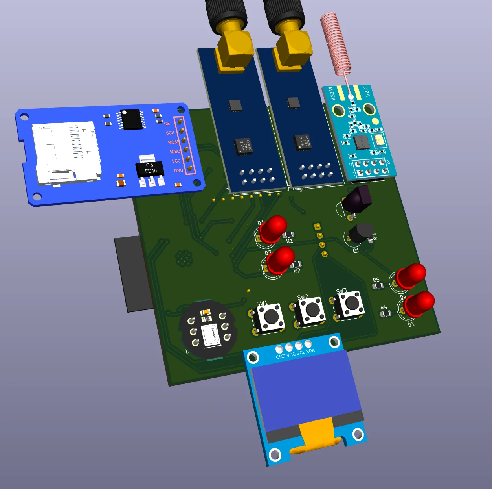
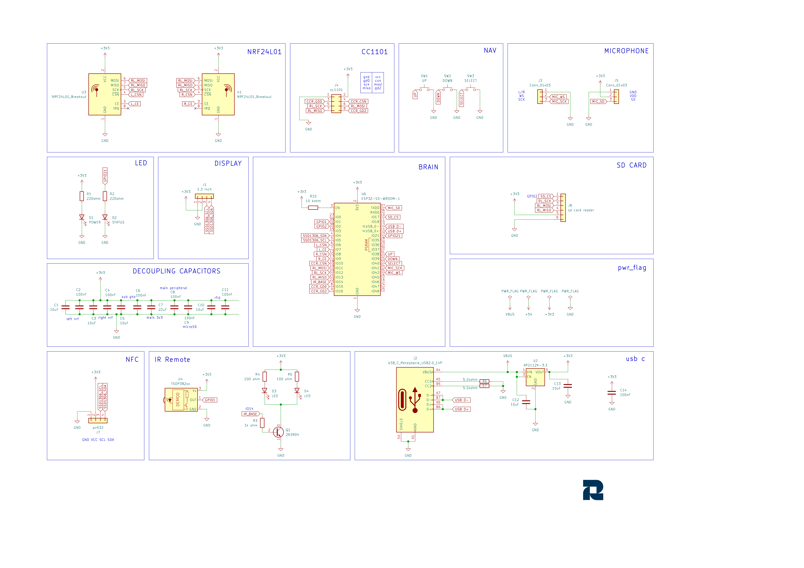
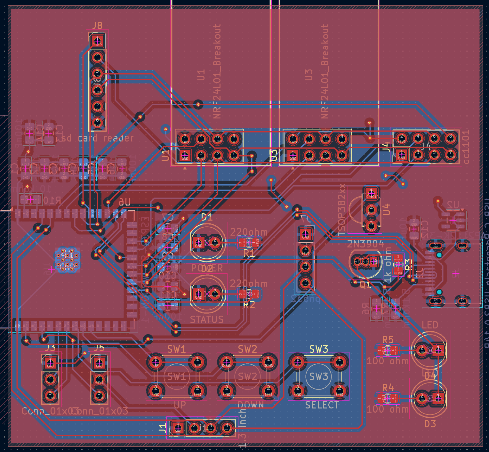
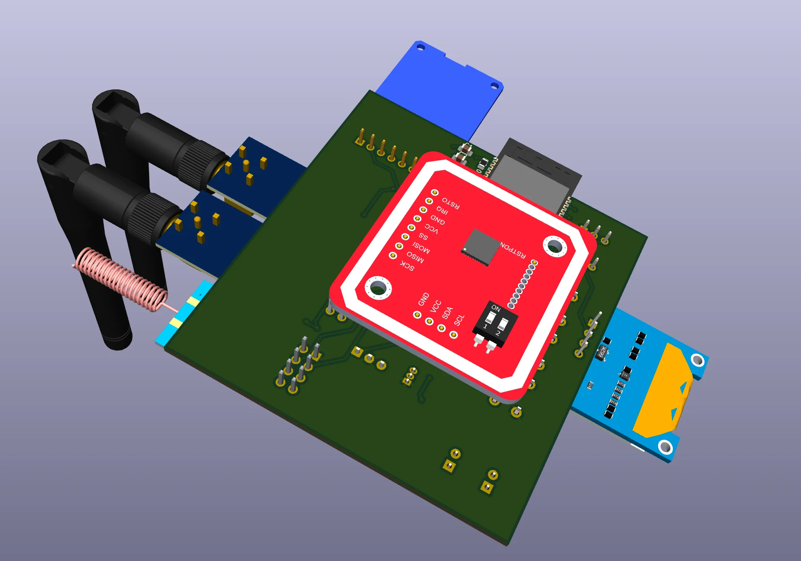

# litezero

### Why did I make it?
bcz i need more hardware projects in my portfolio and also because it seemed like a fun hardware project which was kinda beginner friendly. ALSO I NEEDED A FLIPPER ZERO BUT IT IS SO EXPENSIVE AHHH

### What was the hardest part about this ?
honestly speaking, routing.

Features:

- 2x NRF24L01 for 2.4ghz wireless stuff
- 1x CC1101 for 433 mhz wireless stuff
- 2 status LEDs
- 2 IR LEDs (universal remote)
- 3x tactile buttons to control
- 1x 0.96 inch display for seeing what is going on
- 1x inmp441 for voice commands
- 1x sd card reader to store data
- 1x PN532 breakout board for NFC
- ESP32 S3 WROOM1-N16R8 as the main brain

### How to build it?
1. Order the PCB (with PCBA) from JLCPCB or any PCB manufacturer.
2. Order the different parts from the vendors (available)
3. Solder the NRF modules, LEDs, buttons, SD Card reader and the display on the front side
4. Solder the PN532 board on the back side
5. Use the code given in /prod/firmware and upload it by connecting through the USB C port to your computer and using the Arduino IDE.
6. Give it power through the USB port, then navigate through the buttons and the display attached.
7. voila! now you have a custom built flipper zero!

**DISCLAIMER:** This tool is intended for educational and research purposes only. I do not condone or endorse any illegal, malicious, or unauthorized use of this tool. Misuse includes, but is not limited to, unauthorized access to systems or networks, data theft, spreading malware, compromising accounts, violating others' privacy, disrupting services, or running code with the intent to cause harm. Users are solely responsible for how they use this tool and any code they execute with it. Always obtain proper authorization before testing systems or running security-related experiments.

### Schematic

### PCB 

### 3D view of all parts 

## BOM

[BOM](BOM.csv)
|Name                               |Purpose                 |Quantity|Total Cost (USD)|Link                                                                                                                   |Distributor |
|-----------------------------------|------------------------|--------|----------------|-----------------------------------------------------------------------------------------------------------------------|------------|
|ESP32-S3 WROOM 1                   |Main MCU                |1       |4.69            |https://robu.in/product/espressif-esp32-s3-wroom-1-n16r8-module/                                                       |Robu        |
|NRF24L01 PA+LNA                    |2.4ghz wireless antenna |2       |3.54            |https://robu.in/product/2-4ghz-nrf24l01palna-sma-antenna-wireless-transceiver-communication-module-1km/                |Robu        |
|CC1101                             |433 mhz wireless antenna|1       |3.54            |https://quartzcomponents.com/products/cc1101-sma-antenna-wireless-transceiver-module                                   |Quartz      |
|SD Card Reader                     |For storage purpose     |1       |0.44            |https://www.flyrobo.in/micro-sd-card-reader-module-for-arduino                                                         |Fly Robo    |
|0.96 inch display                  |Display                 |1       |1.5             |https://quartzcomponents.com/collections/all/products/oled-display-0-96-inch-i2c-interface-4-pin-blue-ssd1306          |Quartz      |
|INMP441                            |Microphone              |1       |1.52            |https://quartzcomponents.com/collections/all/products/inmp441-mems-high-precision-omnidirectional-microphone-module-i2s|Quartz      |
|6mm Tactile Buttons                |Buttons for navigation  |3       |0.1             |https://quartzcomponents.com/collections/all/products/6-6-4-3mm-pcb-momentary-tactile-push-button-switch               |Quartz      |
|Status and Power LED               |Status and Power LED    |2       |0               |SELF SOURCED                                                                                                           |SELF SOURCED|
|IR LED                             |IR LED                  |2       |0.1             |https://quartzcomponents.com/collections/all/products/l518eir1bc1-s61-940nm-5mm-infrared-ir-transmitter-led            |Quartz      |
|2N3904                             |Controlling IR          |1       |0.04            |https://quartzcomponents.com/collections/all/products/2n3904-npn-general-purpose-transistor                            |Quartz      |
|TSOP38238 IR Receiver Diode (38kHz)|Controlling IR          |1       |0.14            |https://quartzcomponents.com/collections/all/products/tsop38238-ir-receiver-diode-38khz                                |Quartz      |
|PN532                              |NFC                     |1       |2.77            |https://quartzcomponents.com/products/pn532-rfid-reader-nfc-read-write-module                                          |Quartz      |
|PCB + PCBA                         |Main PCBs + PCBA        |5       |27.82           |https://jlcpcb.com/                                                                                                    |JLPCB       |
|                                   |                        |        |                |                                                                                                                       |            |
|                                   |                        |        |46.2            |                                                                                                                       |            |

## Total Pricing

Final Price comes out to be 4,410 INR ($46.2) [ SHIPPING INCLUDED ]

The pricing might slightly vary due to flash sales, and dollar market trends.